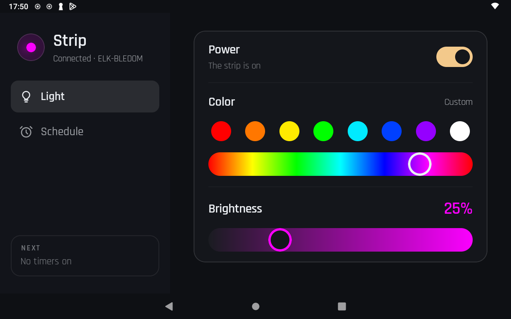
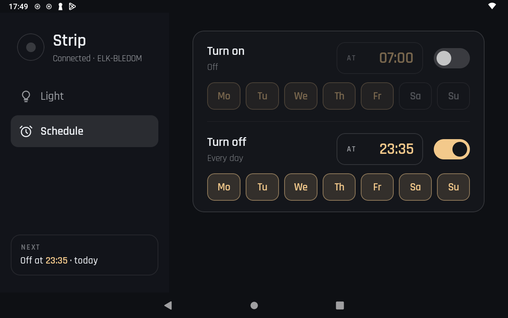
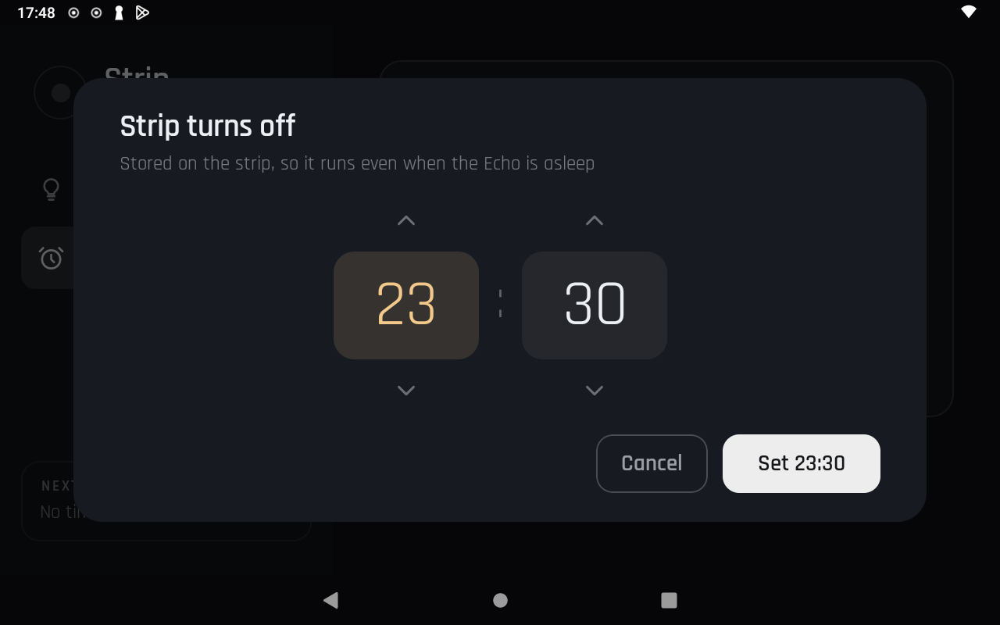

# Strip

A controller for an **ELK-BLEDOM** Bluetooth LED strip, built for an **Amazon Echo Show 8
running LineageOS 18.1**. It does three things: colour, brightness, and the strip's on/off
schedule. The look matches [Haven](https://github.com/iscle/Haven), so the two sit together on
the Echo.

| Light | Schedule | Time picker |
|---|---|---|
|  |  |  |

## What it does

- **Light**: power, eight colour presets, a hue slider, and a brightness slider that takes the
  strip's own colour.
- **Schedule**: the strip's two on-board timers, one to turn on and one to turn off, each with a
  time and weekdays. They are stored on the strip, so they run even when the Echo is asleep.
- **Connection**: finds the strip by name on first run, then reconnects straight to its saved
  address. The Echo holds the strip only while the app is on screen, so a phone can still reach
  it otherwise. Every connection syncs the strip's clock, which it loses whenever it loses power.

The strip cannot report its state, so the last values sent are kept locally and shown as the
current state.

## Protocol

Taken from duoCo Strip 5.4.4. Every command is 9 bytes, written to characteristic `FFF3` of
service `FFF0`. Strips whose name contains `*` use an encrypted variant, which is not
implemented.

| Command | Frame |
|---|---|
| Power on / off | `7E 04 04 E0 00 01 FF 00 EF` / `7E 04 04 00 00 00 FF 00 EF` |
| Colour | `7E 07 05 03 RR GG BB 10 EF` |
| Brightness (0–100) | `7E 04 01 BB FF FF FF 00 EF` |
| Clock | `7E 07 83 HH MM SS WD FF EF` (weekday 0 = Sunday) |
| Timer | `7E 08 82 HH MM 00 MODE DAYS EF` (mode 0 = on, 1 = off; `DAYS` bit 0 = Monday … bit 6 = Sunday, bit 7 = armed) |

See [`ElkBledomProtocol`](app/src/main/java/com/github/iscle/echostrip/data/ble/ElkBledomProtocol.kt)
and its tests.

## Architecture

MVVM on clean architecture, in one module split by layer:

- `domain`: models, repository interfaces and use cases. Plain Kotlin.
- `data`: the GATT link (`ble`), Room (`local`) and the repository implementations.
- `presentation`: Compose screens and ViewModels. Navigation 3 handles the rail's two panes.
- `di`: the [Metro](https://github.com/ZacSweers/metro) graph. Repositories and ViewModels
  contribute themselves, and one factory serves every ViewModel.

Logging goes through Timber, and only in debug builds.

## Build and install

```bash
./gradlew :app:assembleDebug
adb install -r app/build/outputs/apk/debug/app-debug.apk
```

Use a release build on the Echo: it cold-starts in about 1.5 s, against about 10 s for debug.
The app asks for location permission on first launch, because Android 11 only reports Bluetooth
LE scan results to apps that hold it.

```bash
./gradlew :app:testDebugUnitTest
```
